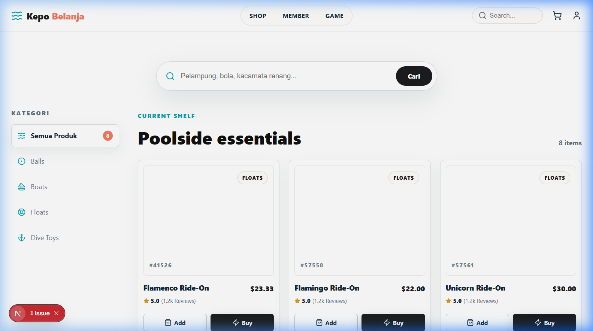
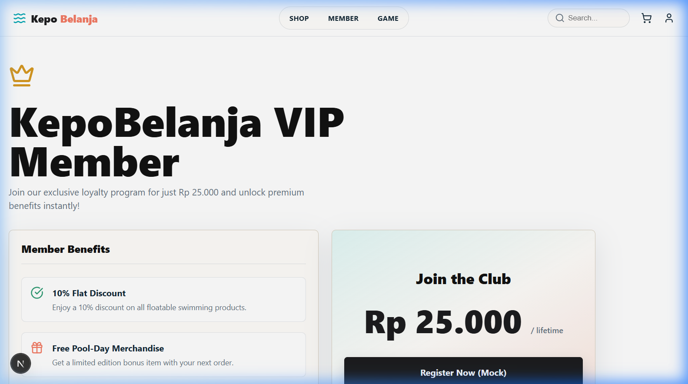
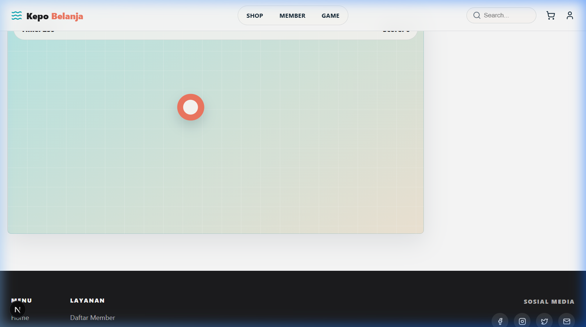
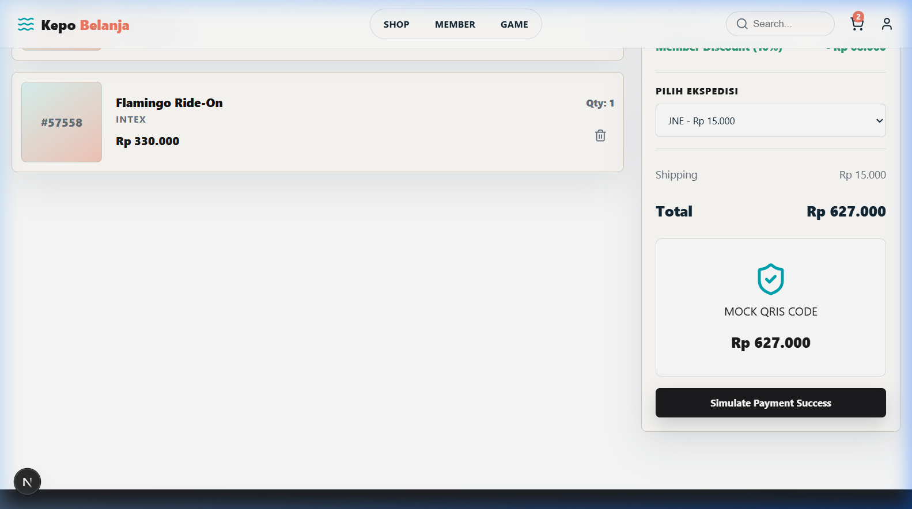
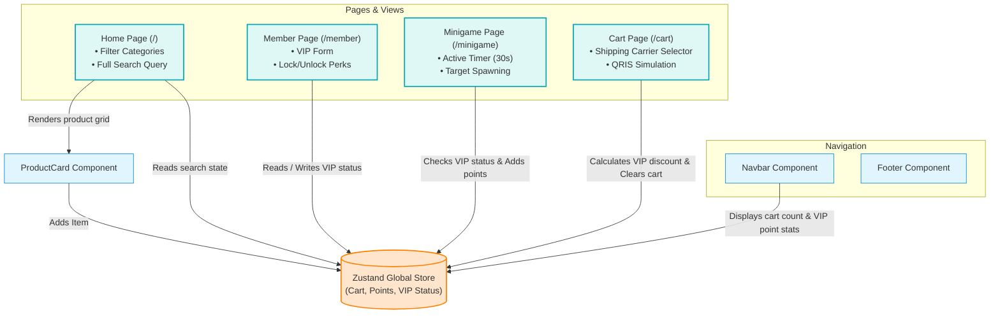

# KepoBelanja 🏊‍♂️🛍️
> A premium, interactive Next.js e-commerce showcase for poolside essentials, loyalty VIP systems, and in-app gamification.

[](#)
[](#)
[](#)
[](#)
[](#)

---

## 📌 Project Overview
**KepoBelanja** ("Curious Shopping" in Indonesian) is a premium, client-commissioned web application representing an e-commerce platform specializing in poolside products, swimming pool gears, and floats.

Designed with rich aesthetics, glassmorphism UI/UX elements, micro-animations, and custom typography, the application demonstrates how modern React features can be orchestrated to deliver an engaging checkout flow alongside loyalty gamification.

> [!NOTE]  
> **Showcase Repository Statement:**  
> This is a public showcase repository created to document the project's features, architecture, and UI. The source code is hosted in a private repository for client confidentiality. Below you will find screenshots of the live application and a detailed layout of the engineering design.

---

## 🖼️ UI/UX Previews

| Catalog & Search (Home) | VIP Member Center |
|:---:|:---:|
|  |  |
| *Clean Sidebar Navigation & Dynamic Product Search* | *Interactive VIP Loyalty Subscription Portal* |

| VIP Minigame "Catch the Float!" | QRIS Simulated Checkout |
|:---:|:---:|
|  |  |
| *Speed-Clicking Gamification to Earn Shopping Points* | *Integrated Cart, Carrier Selector, & QRIS Simulated Flow* |

---

## ⚙️ Architecture & Data Flow

KepoBelanja leverages a modern, single-page application architecture using Next.js App Router for routes, Tailwind CSS v4 and CSS Modules for styling, and a central Zustand store for reactive state synchronization.



---

## 🚀 Key Features

1. **Robust E-Commerce Shell & Search**
   - Live character-matching search filtering by name, brand, custom product code, or item description.
   - Categorized sidebar navigation filtering items (e.g. *All*, *Balls*, *Boats*, *Floats*, *Dive Toys*).

2. **VIP loyalty Program Integration**
   - Mock membership subscription portal (lifetime membership cost simulation).
   - Dynamically checks state across pages to lock/unlock exclusive VIP sections.

3. **VIP Exclusive Perks**
   - Lifetime 10% flat discount automatically calculated and subtracted from the order subtotal at checkout.
   - Eligibility notification for exclusive merchandise.

4. **In-App Gamification ("Catch the Float!")**
   - An interactive 30-second speed-clicking game for logged-in VIP members.
   - Rapid target spawning using React timer loops and random coordinate generators.
   - Earned points instantly increment global store balances, which are shown reactively in the header.

5. **Advanced Cart & simulated QRIS Payment**
   - Individual item count adjustments and real-time total updates.
   - Dynamic shipping cost selector supporting JNE, SiCepat, and J&T.
   - Interactive modal displaying a simulated QRIS payment flow with successful callback simulation that resets the shopping cart.

---

## 🛠️ Technical Stack

- **Framework**: `Next.js 16.2 (App Router)`
- **UI Runtime**: `React 19`
- **State Store**: `Zustand 5`
- **Styling**: `CSS Modules` + `Tailwind CSS 4.0` (for custom layouts)
- **Animations**: `Framer Motion 12`
- **Iconography**: `Lucide React`
- **Language**: `TypeScript 5`
- **Compiler**: `Babel React Compiler` (for performance optimization)

---

## 📂 Codebase Directory Layout (Reference)
The private repository follows Next.js standard best practices:

```text
kepobelanja/
├── src/
│   ├── app/
│   │   ├── layout.tsx         # Global context provider & custom theme styling
│   │   ├── page.tsx           # Homepage (Product listing, Search & Sidebar Filter)
│   │   ├── globals.css        # Root design tokens & global CSS resets
│   │   ├── cart/              # Cart, discount logic, shipping fees, QRIS payment
│   │   ├── member/            # VIP loyalty portal & member status dashboard
│   │   ├── minigame/          # React game component, scoring, & interval timing
│   │   └── product/           # Detail layouts for product catalog items
│   ├── components/
│   │   ├── Navbar.tsx         # Responsive header showing VIP points & Cart status
│   │   ├── Footer.tsx         # Core footer metadata
│   │   └── ProductCard.tsx    # Individual item component (Add to Cart logic)
│   ├── data/
│   │   └── products.ts        # Mock database representing poolside products
│   └── lib/
│       └── store.ts           # Unified Zustand store (State actions & attributes)
```

---

## 👨‍💻 Installation & Local Dev Simulation

*Note: For showcase simulation only. Actual repository is private.*

1. **Install dependencies**:
   ```bash
   npm install
   ```
2. **Start the development server**:
   ```bash
   npm run dev
   ```
3. **Open local instance**:
   Visit [http://localhost:3000](http://localhost:3000) to view the application.

---

## 📝 License
This project is proprietary and built exclusively for client operations. All assets, designs, and content are reserved.
